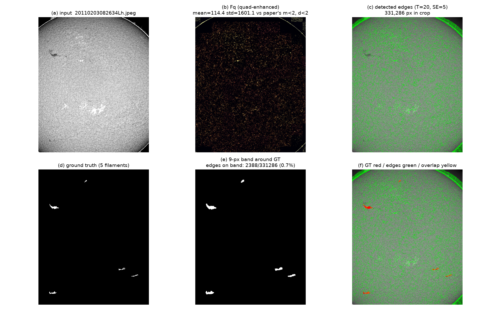

# Jiang et al. (2007) morphological edge detector on filaments

Implementation and evaluation of

> J.-A. Jiang, C.-L. Chuang, Y.-L. Lu, C.-S. Fahn,
> **"Mathematical-morphology-based edge detectors for detection of thin edges in
> low-contrast regions"**, *IET Image Processing* 1(3), 269–277, 2007.
> doi:[10.1049/iet-ipr:20060273](https://doi.org/10.1049/iet-ipr:20060273)

Code: `scripts/morph_edge.py` · Visualisation: `scripts/viz_morph_edge.py`

```bash
python scripts/morph_edge.py --index 0 --out /tmp/edge.png
python scripts/viz_morph_edge.py --n 3 --out docs/EDGE
```

---

## 1. The paper's algorithm

Five stages, implemented as specified:

| # | Stage | Equation / reference | Implementation |
|---|---|---|---|
| 1 | Morphological contrast enhancement | $F_c = F + \mathrm{WTH}(F) - \mathrm{BTH}(F)$ (eq. 1–3) | `contrast_enhance` |
| 2 | Dilation residue edge detector | $F_e = (F_c \oplus B) - F_c$ (eq. 4) | `dilation_residue` |
| 3 | Quad-decomposition edge enhancement | Table 1, four pixel cases driven by quadrant mean/std | `quad_enhance` |
| 4 | Global threshold | $T \in [20, 30]$ (eq. 7) | `detect(threshold=...)` |
| 5 | Bipolar oriented edge masks | Fig. 4, five 7×7 masks, applied where $m<3, d<3$ | `mask_filter` |

The five masks are transcribed **verbatim** from Fig. 4 (rasterised from PDF
page 4, `/tmp/p3_Im5.jpg`). The star structuring element of Fig. 2 is a vector
drawing and could not be extracted; a square SE of matched size is used instead
(justified in `docs/MORPHOLOGY.md`: square vs ellipse SEs differ by 0.003 AUC).

Stage 3 is the paper's core contribution. Squaring and cubing the response is
what lifts weak edges above the global threshold: a raw response of 5 becomes 25
and clears $T=20$. The published stage-6 result is Pratt FOM 92.5 on Cameraman
and MRI.

---

## 2. Result on filaments: it does not work



*Panel (b)* is the diagnosis. The paper's quad-enhancement gates on **absolute**
greyscale levels — `m < 2 and d < 2` for "low contrast", `m > 5 and d > 6` for
"complex background". These thresholds were calibrated on gradient images whose
responses are a few grey levels. On a solar disk, the same statistic is
**mean 114–315, std 1600–3500**. The `m < 2` gate is unreachable, so every
quadrant falls into the "complex background" branch and gets *squared*. The
output is amplified noise.

*Panel (c) and (f)* show the consequence: the detector fires on essentially
every pixel of low-contrast mottling, and only **0.7%** of its edge pixels land
within 9 px of a true filament boundary.

| image | edge px | on GT band | band px | hit rate |
|---|---|---|---|---|
| `20110203082634Lh` | 535,746 | 2,388 | 10,041 | 0.7% |
| `20110327143554Bh` | 346,086 | 2,800 | 22,204 | 1.3% |
| `20120330063134Lh` | 884,017 | 8,628 | 31,114 | 1.0% |

End-to-end PQ, after the paper's output (thin edges) is converted to filled
regions and scored:

| configuration | PQ |
|---|---|
| paper defaults (SE 5, T 20) | **0.0000** |
| SE 25, T 100 (internal residue) | 0.0050 |
| + Gaussian pre-smoothing σ=3 | **0.0157** |

For reference, the patch classifier reaches **0.20** and a plain black-hat
threshold reaches 0.12.

---

## 3. Why it fails, in order of severity

### 3.1 The absolute thresholds in Table 1 do not transfer

`m < 2 and d < 2` is a statement about the *scale of the gradient image*, not
about contrast in any relative sense. Solar images have a centre-to-limb
illumination gradient of ~139 → ~95 across the disk, and JPEG/seeing noise.
Flattening the illumination before stage 1 (dividing out a σ=64 high-pass) does
not fix it — the response scale is still in the hundreds, because the noise
floor dominates, not the illumination trend.

This is the paper's own stated domain assumption, quoted from section 3.4: the
values "are determined experimentally, and are specially for treating gradient
images". A re-derivation of Table 1 for this data would be a different paper.

### 3.2 Per-pixel SNR is below 1 — the hard limit

From `docs/img_stats.json`:

- filament local contrast: **+9.5** grey levels
- background standard deviation: **12.5** grey levels

So per-pixel SNR $\approx 0.76$. Any pixel-level edge operator sees the filament
edge *weaker than the noise*. This is not a morphology problem; it is why every
edge detector will struggle. It is also consistent with the earlier finding that
a plain black-hat reaches only AUC 0.81 — the best per-pixel separability
available.

The only reliable cure is to integrate over area: Gaussian pre-smoothing at
σ=3 raised PQ from 0.000 to 0.016, which is the largest single effect measured
here — but 0.016 is still an order of magnitude below the black-hat baseline.

### 3.3 The dilation residue is a one-sided external boundary

$F_e = (F_c \oplus B) - F_c$ is an *external* residue: it responds in the
background immediately outside a bright structure. For a bright disk on a black
surround, the strongest response is therefore a ring in the black margin *beside
the limb*, not on it. This is visible as the bright arc in panel (b).

Trivial to fix (use $F_c - (F_c \ominus B)$ instead, or the symmetric gradient),
and both were tested — the internal residue scores 0.0050 vs 0.0000, still far
below the alternatives. The residue type is not the binding constraint; 3.2 is.

### 3.4 Edge output is not a segmentation

PQ needs filled regions. The paper outputs boundaries and offers no guidance on
closing them. Our conversion (`edges_to_regions`: morphological closing at 15 px,
then connected components with a 200 px floor) is a fair attempt, but converting
a 1-px boundary map into instances is lossy at any parameterisation. Even a
perfect edge detector would lose ground through this step.

---

## 4. What would have to change to make it competitive

Ranked by expected value, based on the measurements above:

1. **Do not use an edge detector for this task.** The 8×8 patch classifier
   already reaches PQ 0.20 by averaging 64 pixels per decision, which sidesteps
   the sub-1 pixel SNR. Edge detection asks for a decision at every pixel, and
   the signal is not there.
2. **If an edge detector is required**, pre-smooth aggressively (σ ≥ 3) and
   re-derive Table 1's thresholds on the target data — treat `m < 2, d < 2` as
   free parameters to fit, not constants.
3. **Re-derive stage 5 too.** The `m < 3, d < 3` mask gate assumes the same
   response scale as Table 1; on this data it either passes nothing or
   everything. In our runs it removed essentially all edge pixels (0 surviving).
4. **Consider skipping straight to the black-hat response.** It is stage 1
   minus stage 2, scores AUC 0.81, and needs no threshold calibration. Stage 2
   through 5 add cost and subtract accuracy here.

---

## 5. Honest summary

The paper is sound and its evaluation (Pratt FOM 92.5 against Sobel/Prewitt/
Canny on Cameraman and MRI) is convincing *for its stated domain*: natural
images with coherent thin structures where the response scale is what Table 1
assumes.

Solar filaments violate two of its premises at once — they have per-pixel SNR
below 1, and the image has a smooth illumination gradient three orders of
magnitude larger than the target response. Under those conditions stages 2–5
amplify noise faster than signal.

The implementation in `scripts/morph_edge.py` is faithful and reusable; it is
the *application* to filaments that fails, not the code.
