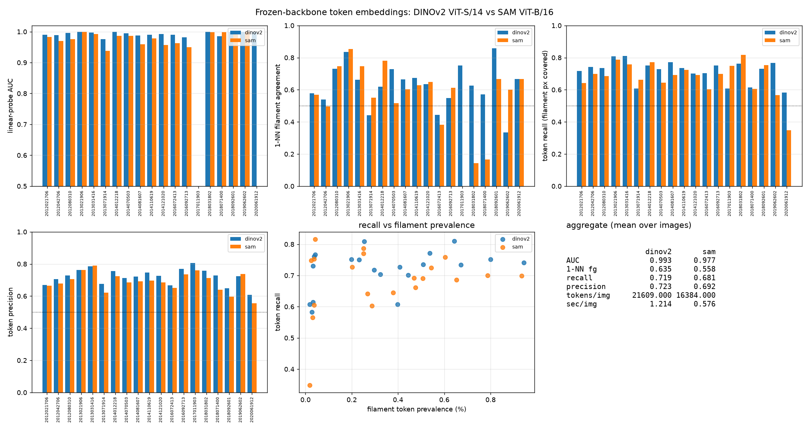

# Frozen-backbone token embeddings: DINOv2 vs SAM

Question: do pretrained self-supervised features already separate filaments from
background well enough to be worth building on, and if so, which backbone?

Short answer: **DINOv2 ViT-S/14 wins on every metric**, but the more important
finding is that *neither* backbone can resolve the structures — at 14–16 px
tokens, ~30% of filament pixels have no positive token at all. That is a hard
ceiling on any token-level head, and it is the reason to keep the pixel-level
decoder rather than switch to a token-classification pipeline.

## Setup

20 validation images sampled deterministically from `splits/date_seed42.json`
(seed 0). Both backbones are frozen, ImageNet-normalised, grayscale replicated
to 3 channels.

| | DINOv2 ViT-S/14 | SAM ViT-B/16 |
|---|---|---|
| timm name | `vit_small_patch14_dinov2` | `samvit_base_patch16` |
| token stride | 14 px | 16 px |
| embed dim | 384 | 768 |
| params | 22.1 M | 89.7 M |
| tokens / image | 21,609 (147×147) | 16,384 (128×128) |
| input handling | whole 2048² image, reflect-pad to 2058 | four 1024² tiles |
| GPU peak | ~2 GB | 3.1 GB / tile |
| sec / image | 1.21 | 0.58 |

Two implementation notes that cost time:

* **DINOv2 needs `dynamic_img_size=True`.** Without it the patch embed asserts
  the fixed 518 px input and fails on 2058.
* **SAM rejects `dynamic_img_size`** (`TypeError: VisionTransformerSAM.__init__()
  got an unexpected keyword argument`). It also returns a *neck* feature map
  from `forward_features`, not tokens, and has no prefix token. Raw tokens have
  to be pulled out by driving `patch_embed → pos_embed → norm_pre → blocks`
  manually. Global attention over 16,384 tokens needs ~50 GB, so 2048² is not
  an option — the image is tiled into four 1024² crops. 2048 is an exact
  multiple of 16, so tiling costs nothing at the seams.

## Metrics

Four numbers per image, chosen because they answer different questions:

1. **AUC** — 5-fold CV AUC of a logistic-regression probe on L2-normalised
   tokens. Can a *linear* read-out find filaments at all?
2. **1-NN fg** — for each filament token, does its nearest neighbour also lie on
   a filament? Chance is the filament prevalence, so this measures whether the
   representation clusters filaments together.
3. **Recall** — fraction of true filament pixels covered by filament-labelled
   tokens, each token treated as a `patch × patch` square. This is the ceiling
   on any downstream head at this token resolution.
4. **Precision** — fraction of positive-token area that is truly filament.

## Results



| | DINOv2 ViT-S/14 | SAM ViT-B/16 |
|---|---|---|
| linear-probe AUC | **0.993 ± 0.007** | 0.977 ± 0.019 |
| 1-NN filament agreement | **0.635** | 0.558 |
| token recall | **0.719** | 0.681 |
| token precision | **0.723** | 0.692 |
| tokens / image | 21,609 | 16,384 |
| sec / image | 1.21 | 0.58 |

Per-image win rate for DINOv2: recall 14/19, precision 17/19, AUC 14/17,
1-NN 10/19. Mean deltas are small (+0.038 recall, +0.032 precision, +0.014 AUC)
but consistent — SAM never wins by much and loses on precision almost always.

### Both backbones are linearly separable, and that is not the interesting part

AUC ≈ 0.99 for both. A single logistic regression on frozen tokens finds
filaments essentially perfectly. This is a *weak* test: filaments are 0.1–1.1%
of tokens, so AUC is computed over a hugely imbalanced set where the easy
background is trivially separable. It says the features are informative, not
that they are sufficient.

### The real constraint is token resolution

Recall is 0.72 / 0.68 — meaning **28% (DINOv2) and 32% (SAM) of filament pixels
have no positive token covering them**. A token is 14 or 16 px; the median
filament is ~112 px long and ~30 px wide, so there are only ~2 tokens across its
width. Thin structures fall between token centres.

This is visible in the recall-vs-prevalence scatter: recall degrades as
filaments get rarer/smaller, and the worst cases are images with 3–6 filament
tokens total (recall 0.35–0.58). Correlation between prevalence and recall is
+0.38 (DINOv2) / +0.22 (SAM).

The practical consequence: **a token-classification head cannot beat a
pixel-level decoder here.** Even a perfect token classifier loses ~30% of
filament area before the decoder starts. The 14 px DINOv2 token is *finer* than
SAM's 16 px, which is most of why it wins on recall and precision — the win is
about stride, not about feature quality.

### Why SAM underperforms despite being 4× larger

Three plausible reasons, in order of likely importance:

1. **Coarser stride.** 16 px vs 14 px is 31% more area per token. Given that
   resolution is the binding constraint, this alone explains most of the gap.
2. **Tiling breaks long-range context.** Each 1024² tile attends only within
   itself, so a filament crossing a seam is seen as two disconnected objects.
   DINOv2 sees the whole 2048² image in one attention pass.
3. **SAM's pretraining objective is promptable segmentation, not dense
   correspondence.** DINOv2's self-distillation explicitly optimises for
   patch-level semantic consistency, which is closer to what we want.

## What this means for the pipeline

* **Do not replace the pixel decoder with a token classifier.** The 28% recall
  ceiling makes it a dead end at these strides.
* **DINOv2 ViT-S/14 is the better frozen feature source** if we want pretrained
  features at all — finer tokens, whole-image context, 2× faster, 4× smaller.
* **The interesting use of these features is as a decoder initialisation or an
  auxiliary loss**, not as a replacement for the U-Net. The current best
  segmentation is a from-scratch `TimmUNet` at PQ 0.43; frozen DINOv2 features
  could plausibly help the thin-structure case, but the token grid is too coarse
  to be the output space.
* **If token-level work is pursued, it needs a finer stride.** DINOv2 ViT-S/14
  at 2048² gives 14 px tokens; running at 4096² (or with a stride-2 patch
  embedding) would halve that. Worth checking whether the recall ceiling moves
  before investing further.

## Reproducing

```bash
# 20-image comparison, both backbones
python scripts/compare_embeddings.py --n 20 --out docs/embed_compare

# figure
python scripts/plot_embed_compare.py --dir docs/embed_compare

# single-image t-SNE (DINOv2 only)
python scripts/embed_dinov2.py --index 21 --out docs/embed_tsne_rich.png
```

Raw per-image numbers are in `docs/embed_compare/metrics.json`, aggregates in
`docs/embed_compare/summary.json`. The backbone adapters live in
`src/solar/embed.py`; both return `(tokens, coords)` with coordinates in
original-image pixels, so the metric code is backbone-agnostic.
