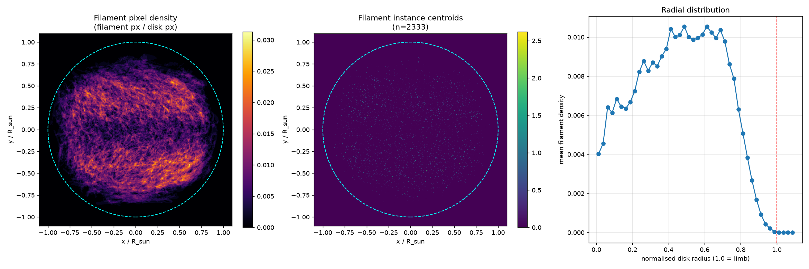
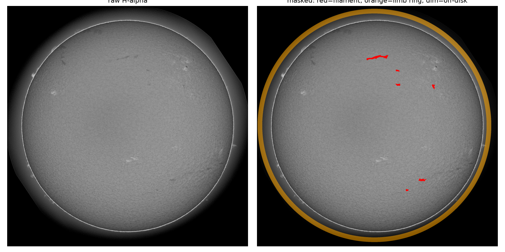

# Filament spatial distribution and disk masking

Where filaments sit on the solar disk, and the disk/limb/off-disk partition the
classical pipeline relies on.

```bash
python scripts/heatmap.py --n all
```

Outputs land in `docs/HEATMAP/`: `heatmap.png`, `disk_mask.png`, `stats.json`.

---

## 1. Why the heatmap needs disk normalisation

A naive accumulation of filament masks in image coordinates is useless, because
the disk is not in a fixed place:

| | median | p05 | p95 |
|---|---|---|---|
| disk radius (px) | 974.8 | 932.1 | 1032.5 |
| disk centre y (px) | 1023.1 | 970.9 | 1084.8 |
| disk centre x (px) | 1024.8 | 982.9 | 1088.3 |

The centre wanders by ±60 px and the radius varies by ±50 px between
observations (different GONG stations, different plate scales). Accumulating
raw masks would blur the limb into a ~100 px annulus and smear every feature.

So each image is resampled into **solar-disk coordinates**: the disk centre maps
to the origin, the disk radius maps to 1.0, and the output grid spans
±1.1 R_sun. The disk is located as the largest bright connected component
(`img > 25`), with radius estimated from its area as $\sqrt{A/\pi}$.



---

## 2. What the heatmap shows

**Left — filament pixel density** (filament px / disk px, per normalised
location). Filaments form the classic **polar crown**: two dense bands at
mid-to-high latitudes in both hemispheres, with a relative deficit near the
equator. This is the expected butterfly/polar-crown structure of H-alpha
filaments, so the annotations are physically consistent.

**Middle — instance centroids** (n = 2,333). Uniformly scattered over the disk
with the same polar weighting. Useful as a sanity check that the pixel-density
pattern is not an artefact of a few enormous filaments.

**Right — radial profile.** Density rises from ~0.004 at disk centre to a
plateau of ~0.010 between 0.4 and 0.7 R_sun, then falls off sharply beyond
0.8 R_sun, reaching zero at the limb.

Two consequences for modelling:

1. **Filaments are rare near the limb.** The drop past 0.8 R_sun is partly
   physical (projection foreshortening) and partly observational (the limb ring
   is bright and steep, so dark features there are hard to see and hard to
   annotate). Either way, the limb region contributes almost no true positives
   but a great deal of false-positive risk.
2. **Density is low everywhere.** Peak density is ~0.03, i.e. at most 3% of
   disk pixels in the densest cell. The global filament pixel fraction is
   0.397% (from `docs/img_stats.json`). This is why patch-level precision was
   the binding constraint in the classifier experiments.

---

## 3. Disk masking



Three regions, all derived from the same largest-bright-blob disk estimate:

| region | definition | treatment |
|---|---|---|
| **Inner disk** | $r < R_\odot - 40$ px | the only region where filaments are searched for |
| **Limb ring** | $R_\odot - 40 \le r < R_\odot$ | excluded; mean intensity 53.6, std 34.3 — a strong dark edge that dominates any threshold |
| **Off-disk** | $r \ge R_\odot$ | excluded; mean intensity 3.2, std 7.2 |

The 40 px margin is not arbitrary. From `docs/img_stats.json`, the limb ring
holds 191.7 M pixels with a std of 34.3 — larger than the entire filament
signal (local contrast +9.5 vs −2.1). Any global or local threshold that is
permissive enough to catch faint filaments will also fire on the limb, which is
exactly the failure mode observed in the early thresholding baseline
(573 FP vs 86 TP at PQ 0.12).

**100.00% of annotated filament pixels lie inside the limb.** No annotation
crosses or touches the limb ring, so masking it out costs nothing in recall and
removes the single largest false-positive source.

### Implementation

`scripts/heatmap.py` exposes the reusable pieces:

```python
disk_geometry(img)   # -> (cy, cx, r) of the solar disk
to_disk_coords(mask, cy, cx, r)   # resample into normalised disk frame
```

The inner-disk mask used by the classifier is
`cv2.erode(disk, ellipse(81, 81))`, i.e. a 40 px margin, applied in
`patch_clf.extract_features` via the `valid` array so out-of-region patches are
never scored.

---

## 4. Numbers

```json
{
  "n_files": 707,
  "disk_radius_px": {"median": 974.8, "p05": 932.1, "p95": 1032.5},
  "disk_centre_px": {
    "y_median": 1023.1, "y_p05": 970.9, "y_p95": 1084.8,
    "x_median": 1024.8, "x_p05": 982.9, "x_p95": 1088.3
  },
  "frac_filament_px_inside_limb": 1.0
}
```

Full radial profile in `docs/HEATMAP/stats.json`.
