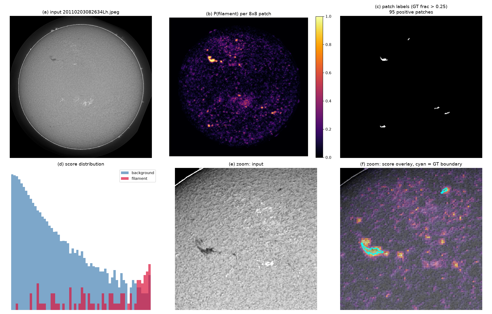
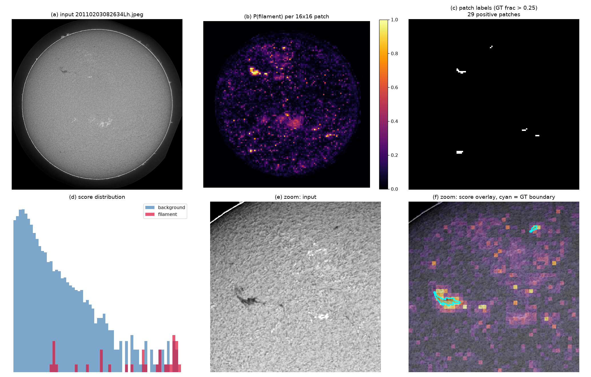

# Is the patch classifier really at AUC 0.95?

Yes — but the number is inflated by the class imbalance, and the score maps show
exactly why PQ is only 0.19.

```bash
python scripts/viz_scoremap.py --model /tmp/rf8_cmp.joblib --patch 8 --index 0
python scripts/viz_scoremap.py --model /tmp/rf16_cmp.joblib --patch 16 --index 0
```

---

## 1. The score map



Panel (b) is the answer to the question. The classifier **does** find the
filaments — the bright spots in (b) line up with the white patches in (c), and
panel (f) shows the score peaking on the cyan GT boundary. It is not broken.

But panel (b) also shows the problem: the map is **diffuse**. There are dozens of
mid-brightness blobs scattered across the disk that are not filaments. Panel (d)
quantifies it — the background distribution has a long tail reaching 0.5+, and
the filament distribution has a long tail reaching down to 0.1. The two overlap
across most of the range.

At `thr=0.7` on this image: 136 patches above threshold, 60 of them true. That
is 44% precision at the patch level, and it is the *good* image.

---

## 2. Why AUC 0.95 coexists with PQ 0.19

### The imbalance inflates AUC

Only **0.22%** of patches in this image are positive (95 of 43,045). AUC is a
*ranking* statistic over all pairs, and 99.8% of those pairs have a background
patch on one side. A model that ranks the easy background correctly gets almost
all of the AUC for free.

Restricting to **hard negatives** — background patches within 24 px of a
filament — tells a different story:

| | pooled AUC |
|---|---|
| all patches | 0.9512 |
| near-filament patches only (4.1% of patches) | **0.8834** |

The 0.07 drop is the part of the AUC that was coming from trivially easy
negatives. 0.88 is still a good ranker, but it is not 0.95.

### AUC does not measure what PQ needs

PQ needs a **decision** at a fixed threshold, and it needs the decision to be
*spatially coherent* — a filament must come out as one connected blob, not as
scattered high-scoring patches.

AUC is invariant to any monotone rescaling of the scores. It cannot see that the
score map is diffuse. Two models with identical AUC can have wildly different PQ
if one produces sharp blobs and the other produces haze.

### Per-image variance is large

| image | positives | AUC (all) | AUC (near) | P@0.7 | R@0.7 |
|---|---|---|---|---|---|
| `20110203082634Lh` | 95 | 0.9833 | 0.9081 | 0.441 | 0.632 |
| `20120427063154Uh` | 768 | 0.9195 | 0.8500 | 0.819 | 0.319 |
| `20120603123034Ch` | 238 | 0.9103 | 0.7997 | 0.361 | 0.218 |
| `20211016145050Bh` | 22 | 0.8186 | 0.8282 | **0.000** | **0.000** |
| `20190626025430Lh` | 32 | 0.9928 | 0.9673 | 0.917 | 0.344 |

Note `20211016145050Bh`: AUC 0.82 but **zero** true positives at `thr=0.7`. The
model ranks its 22 filament patches above most background, yet none clear the
threshold. That is the AUC/PQ gap in a single row.

Also note the precision/recall trade is unstable across images — P@0.7 ranges
0.00 to 0.92, R@0.7 from 0.00 to 0.81. A single global threshold cannot serve
all images, which is a large part of why PQ is low.

---

## 3. 16×16 for comparison



The 16×16 map is visibly **blockier but cleaner** — fewer isolated false blobs,
because each decision integrates 4× the area. The filament at the centre-left is
found as a compact 2×2 block rather than a spray of 8×8 cells.

This is the same trade seen in the PQ numbers: 16×16 has slightly lower SQ
(coarser boundaries) but is closer to its ceiling because its decisions are more
reliable.

---

## 4. What this means

**The classifier is genuinely learning the task.** AUC 0.88 on hard negatives,
and the score peaks on real filaments, is real signal — not an artefact.

**But AUC is the wrong headline metric here.** It is inflated by a 1:450 class
imbalance and blind to spatial coherence, which is what PQ actually scores. The
honest summary statistics are:

| metric | value |
|---|---|
| AUC (all patches) | 0.9512 |
| AUC (near-filament patches) | 0.8834 |
| patch F1 @ best threshold | 0.546 |
| patch precision @ 0.7 | 0.44–0.92 (image-dependent) |
| **PQ** | **0.1875** |

The gap between 0.95 AUC and 0.19 PQ is not a bug. It is the difference between
"ranks patches well" and "produces clean, connected, correctly-thresholded
filament instances" — and the second is much harder.

**Practical consequence:** reporting AUC for this task is misleading. Patch F1
and per-image precision/recall are the metrics that track PQ. If this line of
work continues, the target should be raising patch F1 (currently 0.55) and
stabilising the threshold across images, not raising AUC.
