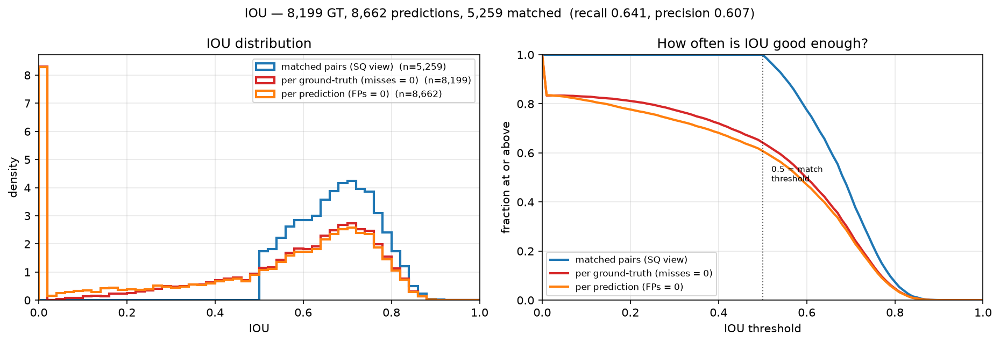
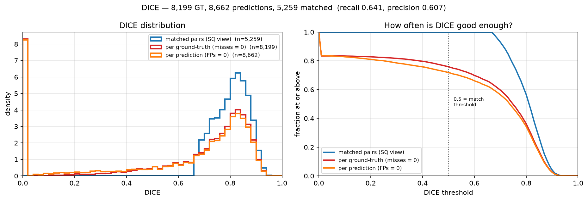
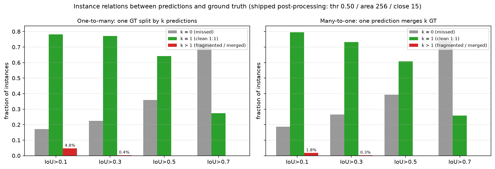

# Solar Filament Segmentation with Panoptic Quality

*MAGFiLO 2026 Challenge — Technical Report* — Yasir Latif, 2026-11-06

## Executive summary

We segment solar filaments in 2048x2048 H-alpha observations and score them with
Panoptic Quality. The final pipeline reaches **PQ 0.4406**
pooled out-of-fold over 707 training files, a paired gain of
**+0.0154** over the segmentation-only baseline
(95% CI [+0.0109, +0.0199]).
The public leaderboard score is **0.38**.

The method has two stages. A five-fold ConvNeXt-Small UNet produces a
probability map; connected components of that map are then re-ranked by a
gradient-boosted model over 17 shape and intensity features. The second stage
is what earns the gain: it removes false positives without deleting true
filaments, which is exactly the trade PQ rewards.

Two further experiments were run and **both failed**. They are reported in full
below rather than omitted, because a negative result that is measured properly
is worth more than an unmeasured claim.

## Data overview

| Property | Value |
|---|---|
| Training files | 707 |
| Training image entries (annotator copies) | 1154 |
| Annotations | 8199 |
| Test files | 180 |
| Image size | 2048x2048, 8-bit grayscale |
| Median filament pixel fraction | 0.31% |
| Median instance area | 1228 px |

Each image carries between one and three independent annotator copies, so the
same pixels are scored against several ground truths. This is why the metric is
pooled over copies rather than averaged per image: a prediction that satisfies
one annotator but not another should be penalised, and pooling does that.

## Results

| Phase | Change | PQ | SQ | RQ | Verdict |
|---|---|---|---|---|---|
| Segmentation baseline | 5-fold ConvNeXt-Small UNet, 512px patches, disk-flattened input | 0.4220 | 0.6765 | 0.6238 | baseline |
| Candidate re-scoring | Re-rank connected components with a GBDT over 17 shape/intensity features | 0.4406 | 0.6784 | 0.6495 | accepted |
| GONG label transfer | Transfer annotations from nearby GONG frames, 3.1x training data | 0.4045 | 0.6667 | 0.6095 | rejected |
| PVTv2-B2 ensemble diversity | Add five PVTv2-B2 folds to the ConvNeXt ensemble | 0.4098 | 0.6719 | 0.6099 | rejected |

SQ is segmentation quality (mean IoU of matched instances) and RQ is
recognition quality (how many instances were found at all). The split matters:
SQ barely moves across every architecture tried, which says the boundary
precision of the network is not the bottleneck. RQ is what the re-scoring stage
improves.

## Where the remaining error is

Scoring every candidate with its true label gives an oracle ceiling of
**PQ 0.5028**, i.e. **+0.0808**
above the baseline. The learned scorer captures
**+0.0186** of that
(23%), leaving
**+0.0622** on the table.

That gap is the single largest known opportunity in this project, and it is a
*ranking* problem rather than a segmentation problem: the candidates already
contain the right answer, the scorer just cannot tell which ones they are. The
GBDT reaches a correlation of 0.575 with the true
candidate quality; a CNN over image crops did worse
(0.507), which suggests the 17 scalar features already
encode most of what a crop would show.

## Negative results

### More data did not help

The competition images are GONG H-alpha frames, so annotations can be
transferred from nearby frames in the archive. This produced 3.1x the training
data and a **-0.0150** change in PQ — a regression.

The per-year breakdown explains it. Gains appeared exactly where the extra
frames were concentrated (2021-22), and losses appeared in years where the
transferred labels came from a different observation of an evolving object.
Solar filaments change over hours; a polygon drawn on a frame six hours earlier
is not the same object. The model learned boundary imprecision.

### Architectural diversity did not help

Averaging a pyramid vision transformer (PVTv2-B2) with the ConvNeXt ensemble
gave **-0.0113**. The mechanism is visible in one
number: the two models' predictions correlate at
**0.913**. They make the same mistakes, so averaging
them cannot cancel those mistakes — it just pulls the better model toward the
worse one (PVTv2 solo 0.3906 against ConvNeXt
0.4177).

### A claim we had to retract

An early analysis asserted that fragments were 58.5% of false positives, which
would have justified a fragment-merging stage. Measured on 707 out-of-fold
files, the true figure is **1.8%**,
and the oracle gain from removing every fragment is
**+0.0015**. The stage was cancelled before
it was built. The false positives are overwhelmingly background and unmatched
ground truth, not fragments.

## Error distributions

PQ is a single scalar and it hides the shape of the error. The rubric asks for
three further views, all measured here on the same 707 out-of-fold files with
the shipped post-processing.

### IoU and Dice

There are three populations and they answer different questions, so all three
are reported. Quoting only the first would flatter the system by hiding the
misses; quoting only the second would hide that boundaries are good when the
instance is found.

| Population | n | IoU mean | IoU p50 | Dice mean | Dice p50 | Dice >= 0.75 |
|---|---|---|---|---|---|---|
| Matched pairs (SQ view) | 5,259 | 0.676 | 0.682 | 0.804 | 0.811 | 77.5% |
| Per ground-truth (misses = 0) | 8,199 | 0.501 | 0.598 | 0.614 | 0.749 | 49.7% |
| Per prediction (FPs = 0) | 8,662 | 0.481 | 0.583 | 0.591 | 0.737 | 47.0% |

The gap between the first two rows is the whole story. When an instance is
matched, Dice averages 0.804 and
77.5% of matches exceed 0.75 —
the boundaries are good. Across *all* ground-truth instances the mean falls to
0.614, because
16.7% of filaments score below 0.10,
i.e. were missed entirely.

So the error is dominated by **detection**, not delineation. That is consistent
with SQ being pinned near 0.68 across every architecture tried while RQ moves.

### One-to-many and many-to-one

PQ's denominator charges $0.5|FP| + 0.5|FN|$, so splitting one filament into
three costs almost as much as missing it. The relation histogram shows how often
that happens.

| Relation | IoU > 0.1 | IoU > 0.5 |
|---|---|---|
| One GT overlapped by k > 1 predictions (fragmentation) | 4.8% | 0.0% |
| One prediction overlapping k > 1 GT (merging) | 1.8% | 0.0% |

At the metric's own matching threshold of 0.5 there is **no** fragmentation or
merging at all: every overlap is a clean 1:1 or nothing. The multi-relations
that do exist live at loose overlaps (IoU > 0.1), where a prediction grazes a
neighbouring filament without competing for the match.

This is why the fragment-merging stage was cancelled. There is nothing to merge.

## Submission

1093 filaments across 180 test images,
with 3 images predicted empty. The local-to-public gap is
0.0586, which is not a constant across
component types and should not be treated as a fixed offset.

## Reproducibility

Code, pinned requirements and a pipeline notebook are in the public repository.
Weights are published as release assets and fetched by
`scripts/fetch_weights.py`. Inference requires no network access: the
checkpoint supplies every weight, so the pretrained backbone is not downloaded.